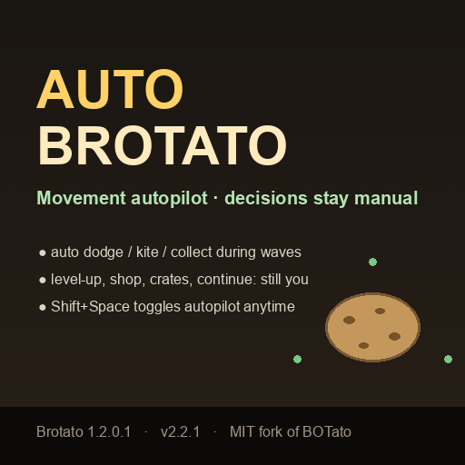

# AutoBattler · Brotato 自动走位 Mod

**操作交给 AI，决策留给你。** 波次内自动走位/闪避/砍树/吃果子/捡材料，商店、升级、开箱、下一波全部手动。

*Auto-move and dodge during waves. Every build decision stays yours.*



[](https://github.com/Shuumatsu/auto-brotato/releases/latest)
[](mod/LICENSE)
[](https://store.steampowered.com/app/1942280/Brotato/)
[](https://steamcommunity.com/sharedfiles/filedetails/?id=3834096920)

## 它做什么

- ✅ 自动躲子弹、冲锋、AOE 预警；静场自动砍树、受伤后去吃果子、顺手捡材料
- ✅ **规划能力（v2.5.0）**：**合围前主动突围** + **高价值物品目标承诺**（DLC 进化果/受伤果子/树），并修好“走到进化物品旁却不捡”的拾取语义
- ✅ **空间规划 / 特殊目标（v2.6.0）**：不再被一点点挤到地图边缘（贴墙带提前撤离 + open-floor 势场）；会主动去处理特殊目标（精英/Boss、生成器蛋、诅咒/进化怪）和特殊产出（物品箱、掉落怪）
- ✅ **DLC 适配（v2.4.0）**：默认主动交战诅咒怪（DLC1）与机械/异变进化怪（DLC2），主动踩进化物品
- ✅ 远程 build 保持射程边缘风筝，不再贴脸（v2.3.0）
- ✅ 每帧不只贪心一步：2 步前瞻规划 + 受击后临时提高警戒（v2.3.0）
- ✅ 从实时 build 数据推导角色行为，不需要逐角色手写表
- ✅ 默认开启，`Shift + Space` 随时接管；HUD 显示状态
- ✅ 只装 2 个最小扩展：**不会替你买、刷、锁、升级、开箱、点下一波**
- ✅ 单人 Brotato 1.2.0.1 实机验证

### v2.6.0 空间规划 / 特殊目标

| 问题 | 修复 |
|---|---|
| 久战会被一点点挤到地图边缘、丧失走位空间 | **贴墙带撤离**：靠近墙（<150px）且 4 只以上敌人贴身时，复用 1.6s 追击 rollout 选“回开阔地”的路线并承诺撤离（不通过人群硬挤）；另有 **open-floor 势场**（380px 内轻微向开阔地收）防止从场地中央被“每一步都局部正确”地挤到边上。`--arb-breakout=0` / `--arb-space=0` 可分别回退 |
| 不主动打特殊怪物（精英/Boss、生成器蛋、诅咒/进化怪） | **赏金目标**：安全窗口内（附近 300px 无身体接触）把 900px 内的特殊目标纳入“-arb-bounty”承诺接近，进入射程后交给正常开火/风筝逻辑；靠太近、血太低或目标消失会放弃。`--arb-bounty=0` 回退 |
| 不捡特殊产出（物品箱/掉落怪） | 物品箱按“一个物品选择”定价（普通 5 / 传说 10，不再只按回血 3 点）；逃跑掉落怪价值 4→6 且纳入目标承诺。`--arb-boxes=0` / `--arb-bounty=0` 回退 |

> v2.6 新增 2 个开关；与 v2.5 的 5 个开关一起全 0 时 = v2.4.0 精确行为（A/B 控制臂）。

### v2.5.0 规划能力（合围前突围 / 高价值物品）

| 问题 | 修复 |
|---|---|
| 肉眼看到“马上要被包围”，bot 不提前规划 | **预判突围**：把追击者投影到 1.8s 后，算“现在还能过人、1.8s 后缺口就没了”的合围前兆；进入突围模式后用 16 方向 × 1.6s 追击 rollout 选逃逸线并承诺跑出去（接触价打折，子弹/冲锋/AOE 仍全价）。`--arb-breakout=0` 精确回退 |
| 不会规划去捡高价值物品 | **目标承诺**：安全窗口内按 `价值/ETA` 选目标（进化物品/受伤果子/树）并持续拉过去，而不是只吃路过的；`--arb-goal=0` 回退 |
| 走到进化物品旁却不捡 | **walk-on 拾取语义修复**：v2.4 的 45px rim 被当成“held 复活圈”（站圈里刷分、不消费），现在按一次性拾取；另加“落在目标上的分段速度”候选，修掉最后一个 horizon 步内全速过冲→停住的问题。`--arb-walk=0` 回退 |
| 波末的进化果来不及捡 | meca/mutant fruit 波末不会自动吸走，world_view 现在按剩余波时给价值乘 1→4 的紧迫度；`--arb-waveend=0` 回退 |
| 2 步前瞻按直线外推追击者 | 第二层改为**追击预测**（朝第一动作终点转向）；`--arb-pursuit=0` 回退 |

> 五个开关全 0（`--arb-breakout=0 --arb-goal=0 --arb-pursuit=0 --arb-walk=0 --arb-waveend=0`）= v2.4.0 精确行为，方便 A/B 与回退。

### v2.4.0 DLC 适配（诅咒怪 / 进化物品）

| 问题 | 修复 |
|---|---|
| 遇到诅咒怪（DLC1）只风筝不打 | 被诅咒敌人默认 **×3 目标价值**（更愿意把它保持在武器射程内打掉），可调：`--arb-curse=3`；需要避开时用负数（`--arb-curse=-1` → 不主动靠近、威胁伤害 ×2） |
| 不打机械/异变进化怪（DLC2），拿不到它们的进化掉落 | 进化敌人默认 ×2.5 目标价值；`--arb-evolved=2.5`，负数同样进入回避姿态 |
| 进化物品（机械果实/异变果/异变基因/机械部件）躺在原地不捡 | 按 DLC 进度定价并**走到物品上**拾取（这些消耗品不会被吸引圈收走）；只捡当前进化方向可用、且游戏允许拾取的；`--arb-evo=1.0` 缩放价值，`0` 精确回到 2.3.0 |
| 未知/毒果等非治疗消耗品被当成食物 | 非治疗消耗品不再按“掉血治疗”定价（毒果不会再被主动吃）；治疗类（普通果实/物品箱）行为不变 |

> 三个开关同时为 0（`--arb-curse=0 --arb-evolved=0 --arb-evo=0`）时与 2.3.0 行为逐值一致，便于 A/B 回退。

### v2.3.0 策略升级

| 问题 | 修复 |
|---|---|
| 远程英雄老是贴脸 | 新增 standoff 项：把敌人保持在射程的 75%（掉血时更远），旧行为可用 `--arb-kite=0` 精确回退 |
| 不砍树 / 不吃果子 | 普通 role 也给树一个静场价值；受伤时果子价值 ×2.5（`--arb-tree=0` / `--arb-food=0` 回退） |
| 单步贪心不够聪明 | `choose()` 增加 2 步前瞻（beam 4 × 8 方向），用同一套威胁模型/代价函数；`--arb-plan=0` 精确回退 |
| 受击后反应迟钝 | 单次掉血 ≥12% 触发 2 秒警戒期（威胁权重 +25%）；`--arb-adapt=0` 回退 |

> 一句话：从“操作员”变成“指挥官”。

## 安装

- **Steam Workshop（推荐）**：[订阅这里](https://steamcommunity.com/sharedfiles/filedetails/?id=3834096920)
- **GitHub / 本地版**：从 [Releases](https://github.com/Shuumatsu/auto-brotato/releases) 下载**单个 zip**；
  它已经包含 Mod 本体 + 预览图 + Workshop 描述，Steam 版放进已订阅的工坊 item 目录即可，
  步骤见 [安装文档](docs/TECHNICAL.md)。

## 操作

| 场景 | 行为 |
|---|---|
| 波次中 | 不操作即可，角色自动走位 |
| `Shift + Space` | 关闭 / 恢复自动走位 |
| 升级三选一、商店、开箱、下一波 | 完全手动 |

## 开发 / 发布

```bash
./build.sh          # 开发用 Mod zip: dist/AutoBattler-<version>-fork.zip
./build_release.sh  # 发布用单文件整包: dist/AutoBattler-v<version>.zip
```

- 自动 benchmark / 参数标定：[calibration/README.md](calibration/README.md)
- GitHub Actions 构建与 Release：push `vX.Y.Z` tag 自动发布
- 详细原理、适配机制、验证记录、CI/CD：[docs/TECHNICAL.md](docs/TECHNICAL.md)

## 致谢

走位 AI 来自开源项目 [BOTato](https://github.com/boardengineer/botato)（by boardengineer / Pasha，MIT License，见 [mod/LICENSE](mod/LICENSE)）。
本仓库只做瘦身、默认开启、配置/HUD、自动 profile 与打包。
